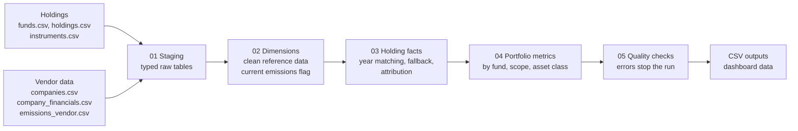

# Climate Disclosure Warehouse

A SQL pipeline that turns fund holdings and vendor emissions data into the climate metrics a fund publishes: financed emissions, carbon footprint, weighted average carbon intensity (WACI) and data coverage, by fund, scope and asset class.

All data in this repo is synthetic. Company names, financials, emissions and fund holdings are generated from a fixed random seed. The design is based on a production climate reporting warehouse I built for a New Zealand KiwiSaver provider; this is a fresh implementation, not that code.

**[View the dashboard](Dashboard/index.html)** (open `Dashboard/index.html` in a browser, or publish `Dashboard/` with GitHub Pages)

## What it does



One command builds everything:

```
pip install -r requirements.txt
python src/generate_data.py     # synthetic inputs in data/raw
python src/pipeline.py          # builds output/warehouse.duckdb, runs checks, exports results
python -m pytest                # known-answer tests
```

The pipeline uses DuckDB, so there is no database server to set up. Moving it to SQL Server, Snowflake or Postgres needs a few syntax changes (`UNPIVOT`, `GROUP BY ALL`, `make_date`); the table design and logic carry over as they are.

## The problems it handles

Real emissions data is incomplete and changes after delivery. The pipeline deals with each case explicitly and reports it.

| Problem | How it is handled |
|---|---|
| Company has not reported the latest year yet | Uses the prior year's emissions **and** the prior year's EVIC and revenue, and flags the holding. The share of value on prior-year data is reported for every fund. |
| Vendor restates a figure | Every delivery is kept. The latest delivery for each company, year and scope is flagged as current. |
| Company never reports Scope 3 | Coverage is reported per scope, so Scope 3 metrics show they rest on about half the portfolio. |
| Sovereign bonds and cash | Counted in fund value, excluded from corporate metrics. |
| Bonds and equities need different values | Equities use market value; corporate bonds use face value (outstanding amount), following PCAF. |
| Zero or negative vendor values | Treated as missing, not as zero emissions. |

## Metrics

| Metric | Formula | Unit |
|---|---|---|
| Attribution factor | holding value ÷ company EVIC | share |
| Financed emissions | Σ attribution factor × company emissions | tonnes CO₂e |
| Carbon footprint | financed emissions ÷ covered holding value ($m) | t per $m invested |
| WACI | Σ weightᵢ × (emissionsᵢ ÷ revenueᵢ), weights = share of covered value | t per $m revenue |
| Coverage | covered value ÷ corporate value | % |

Each metric is produced for Scope 1, Scope 2, Scope 1+2 and Scope 3, for listed equity, corporate bonds and all corporate holdings combined.

### Worked example

A fund holds two companies:

| | Holding | EVIC | Revenue | Scope 1+2 (t) |
|---|---|---|---|---|
| Company A | $10m | $1,000m | $800m | 500,000 |
| Company B | $5m | $250m | $100m | 40,000 |

**Financed emissions**

- A: (10 ÷ 1,000) × 500,000 = 5,000 t
- B: (5 ÷ 250) × 40,000 = 800 t
- Total: **5,800 t**

**Carbon footprint**

- 5,800 ÷ 15 = **386.7 t per $m invested**

**WACI**

- Intensities: A = 500,000 ÷ 800 = 625 t per $m revenue; B = 40,000 ÷ 100 = 400
- Weights: A = 10 ÷ 15 = 0.667; B = 5 ÷ 15 = 0.333
- WACI = 0.667 × 625 + 0.333 × 400 = **550 t per $m revenue**

These numbers are the first test in `tests/test_metrics.py`.

### Year matching

Reports are dated 31 March. A 31 March 2025 report uses the financial year ending 31 December 2024. If a company has not reported that year, the pipeline uses the year ending 31 December 2023, together with that year's EVIC and revenue, and sets `is_fallback`.

## Data quality checks

Run after every build. Errors stop the pipeline with a non-zero exit code; warnings are reported and the run continues.

| Check | Severity | Tests for |
|---|---|---|
| Q01 | error | Holdings that reference an unknown instrument |
| Q02 | error | Duplicate holdings |
| Q03 | error | Zero or negative market values |
| Q04 | error | More than one current emissions figure per company, year and scope |
| Q05 | error | Attribution factor above 1 |
| Q06 | error | Coverage outside 0 to 100% |
| Q07 | error | Fund value in the fact table not reconciling to staged holdings |
| Q08 | warning | Corporate bonds with no face value |
| Q09 | warning | Scope 1+2 coverage below 80% |
| Q10 | warning | More than 10% of value on prior-year emissions |
| Q11 | warning | Figures restated by the vendor |

Every run also writes row counts, null counts on key columns and timings to `meta.run_log`.

## Tests

`tests/test_metrics.py` builds small hand-made datasets and checks the answers:

- the worked example above (5,800 t, 386.7, 550)
- cash counts in fund value but not in the metrics
- Scope 1 + Scope 2 equals Scope 1+2
- the prior-year fallback uses the older EVIC and is flagged
- a restatement replaces the earlier delivery
- missing emissions reduce coverage, not the footprint
- an unknown instrument stops the pipeline

## Project layout

```
data/raw/               synthetic input files (regenerate with src/generate_data.py)
sql/01_staging.sql      typed raw tables
sql/02_dimensions.sql   funds, companies, instruments, financials, emissions with current flag
sql/03_fact_holdings.sql   one row per holding and scope: year matching, attribution
sql/04_fact_metrics.sql    fund metrics by scope and asset class, top contributors
sql/05_quality_checks.sql  data quality checks
src/generate_data.py    synthetic data generator
src/pipeline.py         runs the SQL, logs, checks, exports
tests/test_metrics.py   known-answer tests
Dashboard/index.html         dashboard (reads Dashboard/data.js)
output/                 warehouse.duckdb and result CSVs (not committed)
```

## Using your own data

Put files with the same names and columns in a folder and run:

```
python src/pipeline.py --raw path/to/your/files
```

Amounts are in NZD. EVIC and revenue are in $m; holdings are in dollars.

## Limits

- One currency. A real build would convert holdings, EVIC and revenue at consistent dates.
- No PCAF data quality scores, estimated emissions or sovereign emissions.
- Scope 3 is used as reported, with no adjustment for double counting.
